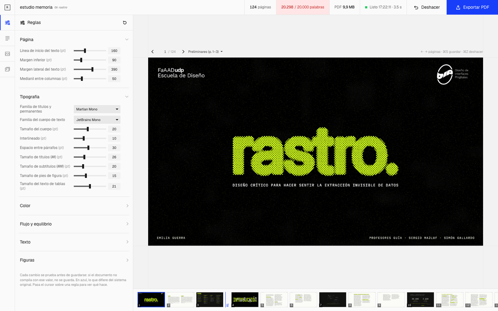

# estudio memoria

Editor local para diagramar la memoria de título de ***rastro*** (Diseño, UDP, 2026).
Cambia las reglas de diagramación, el texto, las láminas y las imágenes del documento,
y muestra el resultado en la página en segundos.



## Para qué se creó

La memoria se diagrama con [Typst](https://typst.app), un sistema paramétrico como LaTeX:
el diseño son reglas (márgenes, columnas, tamaños, cuándo cortar una página) y no cajas
movidas a mano. Cada ajuste obligaba a pedir el cambio, esperar y revisar. Este editor
expone esas reglas en un panel para ajustarlas directamente, ver el efecto al instante
y no romper nada en el intento.

## Qué hace

| Pestaña | Qué permite |
|---|---|
| **Reglas** | 33 reglas en seis grupos: página, tipografía, color, flujo y equilibrio, texto y figuras. Cada una con su valor por defecto, su rango y un ↺ para volver atrás. |
| **Texto** | Editar el Markdown de cada capítulo con el conteo de palabras contra el límite de 20.000. |
| **Láminas** | Catálogo de los diagramas del sistema con miniatura y dónde se usa cada uno. Se insertan en el texto o al costado de él. |
| **Imágenes** | Repositorio de imágenes con arrastrar y soltar. Arma láminas y composiciones con título y fuente APA. |

Al centro se ve la página compilada; arriba, páginas, palabras, peso del PDF y estado.

**Lo que no deja pasar:**
- Una regla solo se guarda si el documento compila con ella.
- Si un capítulo cambió fuera del editor, no lo pisa: avisa.
- Cada guardado deja una copia en `historial/`, y está el botón Deshacer.
- Las imágenes se ajustan a 2000 px y no se puede borrar una que esté en uso.
- Las láminas se insertan entre párrafos, nunca a mitad de uno.

El detalle de cada riesgo y su decisión está en [ROAST.md](ROAST.md).

## Cómo se usa

Requisitos: macOS, Python 3 con Pillow y Typst 0.15.

1. Doble clic en `abrir-editor.command`. Se abre el navegador en `http://127.0.0.1:8790`.
2. Mueve una regla, edita un capítulo o inserta una lámina; la página se actualiza sola.
3. **Exportar PDF** compila el documento final.

Atajos: ← → cambian de página · ⌘S guarda el texto · ⌘Z deshace la última regla.

Sin el doble clic: `python3 servidor_memoria.py`. El editor necesita que el servidor siga
abierto.

## Qué hay acá

```
editor/
├── estudio-memoria.html   interfaz (panel a la izquierda, página al centro)
├── servidor_memoria.py    servidor local: valida, guarda y compila con Typst
├── esquema.json           cada regla: nombre, tipo, rango, valor por defecto y ayuda
├── reglas.json            solo lo que se cambió respecto del esquema
├── abrir-editor.command   lanzador de doble clic
└── ROAST.md               qué podía salir mal y cómo se resolvió
```

El editor vive dentro de `diagramacion/` y trabaja sobre lo que está al lado:

- `memoria.typ` arma el documento;
- `reglas.typ` lee `esquema.json` + `reglas.json` y se los entrega a Typst;
- `laminas.typ` contiene el catálogo de láminas;
- `limpias/` guarda los capítulos en Markdown;
- `imagenes/` es el repositorio.

Esos archivos (y el contenido de la memoria) **no están en este repo**: contienen el texto
de la tesis y material de participantes.

Para agregar una regla nueva se suma a `esquema.json` y se lee en Typst como
`R.<grupo>.<id>`: aparece sola en el panel.

## Referencias

- [Typst](https://typst.app): motor de composición del documento.
- [cmarker](https://typst.app/universe/package/cmarker): Markdown dentro de Typst.
- [Brik](https://brik.space/gallery): referente de la interfaz (controles en acordeón,
  lienzo con guías, barra en celdas).
- [Geist](https://vercel.com/font): tipografía de la interfaz.
- El estudio de posts de Instagram de ***rastro***: primer editor del mismo tipo, del que
  nace la idea.

---

Emilia Guerra · Memoria de título, Diseño, UDP · 2026
